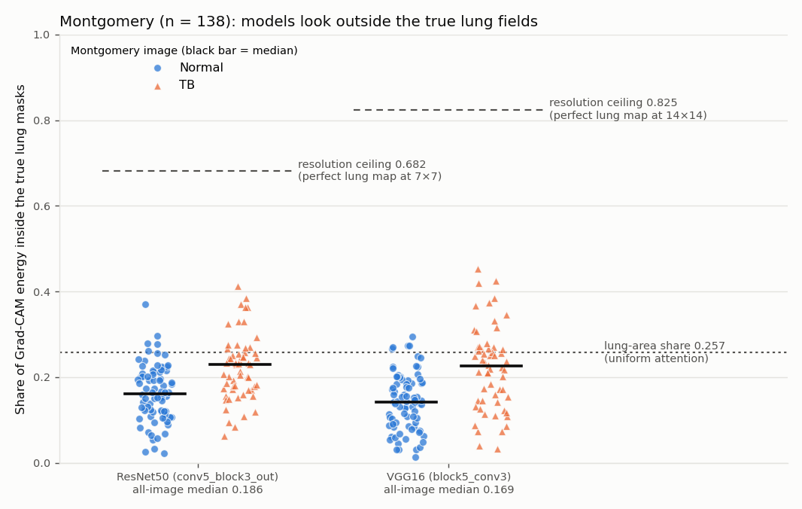

# Tuberculosis detection from chest X-rays: a case study in dataset confounding

> **TL;DR:** 0.998 internal AUC did not transfer: 0.669 / 0.656 (ResNet50) on two external hospital datasets (Shenzhen, Montgomery; 800 images, pre-registered hypotheses); VGG16 and EfficientNet at chance. The models largely learned dataset-source shortcuts; ResNet50 keeps some real signal. See [External validation](#external-validation) and [Key finding](#key-finding-dataset-confounding).

[](https://github.com/shubhampandey97/tuberculosis-detection-v2/actions/workflows/ci.yml)


## Summary

This project trains three ImageNet transfer-learning models (ResNet50, VGG16 and EfficientNetB0) to flag TB on chest X-rays, and then audits them. The pipeline uses:
- a de-duplicated, stratified, seeded train/val/test split;
- one preprocessing path shared by training, evaluation and the app;
- screening metrics with bootstrap confidence intervals, and a threshold tuned on the validation set;
- calibration, masking and Grad-CAM analyses;
- external validation on two public hospital datasets, with hypotheses written down before any external predictions existed.

The audit's main result is a negative one. In this dataset the TB and Normal images come from different sources, and the models learn that difference: markers, handwritten annotations, compression. The internal scores are an **upper bound**, not evidence of clinical performance, and the external validation confirms it.

**This is a research and portfolio project, not a medical device. Do not use it for diagnosis.**


*TB.1.jpg (a TB image carrying the Normal-style marker: an "L" in the top-right corner) is not flagged: score 0.122, threshold 0.614. This image is from the **training** split, so it's an example of the bias, not a held-out result.*

## Results (held-out test set)

- **Test set:** 448 images (77 Normal, 371 TB), never used for training, threshold tuning or model selection.
- **Primary model:** ResNet50, chosen on **validation** AUC.
- **Threshold:** for each model, the highest threshold that gives **≥ 95% sensitivity on the validation set**, applied unchanged to test.
- **Intervals:** 95% CIs from a stratified bootstrap (2,000 resamples, seed 42).
- **Rounding:** values are truncated, not rounded, to 3 decimals.

| model | threshold | sensitivity | specificity | PPV | NPV | F1 | ROC-AUC |
|---|---|---|---|---|---|---|---|
| **ResNet50 (primary)** | 0.6142 | **0.935** (0.908–0.959) | **1.000**\* (77/77) | 1.000\* (347/347) | 0.762 (0.693–0.836) | 0.966 (0.951–0.979) | **0.998** (0.996–0.999) |
| VGG16 | 0.2357 | 0.929 (0.902–0.954) | 0.987 (0.961–1.000) | 0.997 (0.991–1.000) | 0.745 (0.675–0.819) | 0.962 (0.947–0.976) | 0.991 (0.982–0.998) |
| EfficientNetB0 | 0.3257 | 0.946 (0.921–0.967) | 0.987 (0.961–1.000) | 0.997 (0.991–1.000) | 0.791 (0.723–0.863) | 0.970 (0.957–0.982) | 0.996 (0.991–0.999) |

\* There were no errors, so the bootstrap interval collapses to 1.000–1.000. Exact (Clopper–Pearson) 95% lower bounds: specificity ≥ 0.953 and PPV ≥ 0.989.

How to read these numbers:
- **The 95% sensitivity target was met on validation but not on test** (0.929–0.946).
- **PPV and NPV reflect this dataset's 83% TB prevalence,** not a screening population.
- **The scores are not calibrated.** P(TB) is under-estimated in the middle range.

Full tables, results at threshold 0.5, and calibration: [docs/audit.md](docs/audit.md) (goal 4) and [artifacts/clinical/](artifacts/clinical/).

### Before and after the preprocessing fix

The original pipeline trained on pixels scaled to [0, 1] but evaluated on raw 0–255 pixels, and none of the models got its own `preprocess_input` (audit §5.1). It also evaluated on the validation split it had trained against.

| model | legacy ROC-AUC (**invalid**) | fixed ROC-AUC (held-out test) |
|---|---|---|
| ResNet50 | 0.302 | 0.998 |
| VGG16 | 0.985 | 0.991 |
| EfficientNetB0 | 0.148 | 0.996 |

The legacy numbers come from the broken preprocessing and a leaky, different split. They show that the bug was fixed; they are **not** a fair comparison of performance. They are kept in [artifacts/legacy/](artifacts/legacy/README.md) for this table only.

A second, smaller mismatch turned up while building the app: decoding JPEGs with PIL instead of TensorFlow (a different IDCT) shifted test scores by up to 0.024. The app now uses the same TensorFlow decode as training (max difference 1.6e-7 against the saved test predictions).

## Key finding: dataset confounding

1. **Metadata alone predicts the label.** A depth-3 decision tree that never sees the anatomy, only file size, brightness and contrast, reaches **AUC 0.918** (5-fold CV). File size alone reaches 0.861. Normal images all share one look (an "L" marker, similar exposure); TB images carry "R" markers, handwritten names and dates, and varied exposure. Source: [notebooks/01_data_audit.ipynb](notebooks/01_data_audit.ipynb), audit §5.3 item 7.
2. **The models still work with the lungs hidden.** With the central 170×170 of each 224×224 test image replaced by grey, test AUC stays at **0.971** (ResNet50), **0.974** (VGG16) and **0.912** (EfficientNetB0). Mean brightness alone gives only 0.576, so the grey fill doesn't explain it. ("Lungs hidden" is approximate: the lung tops and outer lung edges stay visible.)
3. **Grad-CAM lands on annotations.** In several correctly detected TB images the heatmaps sit on handwritten text and labels at the image edges. VGG16 puts about half of its TB evidence on the outer 12% border.
4. **The shared misses look like the Normal source.** The 7 TB images that all three models miss have Normal-like large files and low contrast, and none has the handwriting. **TB.1892** shows visible opacities and is still called Normal by every model (P(TB) 0.361 for ResNet50, 0.124 for VGG16).


*Grad-CAM for the decision made (ResNet50 middle, VGG16 right) on the 7 shared misses and the one shared false positive. The dashed box marks the inner edge of the 12% border.* Full analysis: [docs/failure_analysis.md](docs/failure_analysis.md).

## External validation

The frozen models were tested, without retraining, on two public NLM datasets where TB and Normal come from the **same hospital and acquisition pipeline**:
- **Shenzhen:** 662 images, 326 Normal / 336 TB.
- **Montgomery County, MD:** 138 images, 80 Normal / 58 TB.

Method:
- The val-tuned thresholds were applied **unchanged**.
- The images were converted to match the training format (8-bit gray, antialiased resize to 256×256, then the unchanged model input path).
- No intensity normalisation was applied, a choice made in advance.
- An overlap check against all 2,982 training images, including a crop search with a positive control, found **0 shared radiographs**.
- Hypotheses H1–H6 were written into [docs/audit.md](docs/audit.md) before the relevant outputs existed.

| model | data (n Normal / TB) | ROC-AUC | sensitivity | specificity |
|---|---|---|---|---|
| **ResNet50** (primary) | internal test (77 / 371) | 0.998 (0.996–0.999) | 0.935 (0.908–0.959) | 1.000 (77/77; exact ≥ 0.953) |
| | Shenzhen (326 / 336) | **0.669** (0.628–0.709) | 0.907 (0.875–0.937) | **0.208** (0.165–0.254) |
| | Montgomery (80 / 58) | **0.656** (0.559–0.748) | 1.000 (58/58; exact ≥ 0.938) | **0.000** (0/80; exact ≤ 0.045) |
| VGG16 | internal test (77 / 371) | 0.991 (0.982–0.998) | 0.929 (0.902–0.954) | 0.987 (0.961–1.000) |
| | Shenzhen (326 / 336) | 0.470 (0.427–0.514) | 0.699 (0.648–0.747) | 0.165 (0.125–0.205) |
| | Montgomery (80 / 58) | 0.581 (0.479–0.683) | 0.965 (0.913–1.000) | 0.000 (0/80; exact ≤ 0.045) |
| EfficientNetB0 | internal test (77 / 371) | 0.996 (0.991–0.999) | 0.946 (0.921–0.967) | 0.987 (0.961–1.000) |
| | Shenzhen (326 / 336) | 0.521 (0.477–0.565) | 0.476 (0.422–0.529) | 0.533 (0.478–0.585) |
| | Montgomery (80 / 58) | 0.537 (0.442–0.639) | 1.000 (58/58; exact ≥ 0.938) | 0.012 (0.000–0.037) |

At the val-tuned thresholds, with 95% bootstrap CIs (2,000 resamples), truncated to 3 decimals. ResNet50 flags **every** Montgomery image as TB. Even with a threshold chosen on the external data itself (an "oracle", not a result), 95% sensitivity would leave specificity at only 0.141 (Shenzhen) and 0.025 (Montgomery).

**Pre-registered hypotheses:**
- **H1** external AUC below internal: **supported** (6 of 6 model–site pairs; every CI upper bound ≤ 0.748, against ≥ 0.991 internally).
- **H2** low Montgomery specificity: **supported** (ResNet50 0.000).
- **H3** overlap would inflate results: **not testable** (0 confirmed overlaps).
- **H4** JPEG compression raises AUC: **not supported** (\|JPEG − PNG\| ≤ 0.012; every per-site paired CI includes 0).
- **H5** most external Normals flagged TB, with AUC holding better than specificity: **prediction supported, stated reason only partly supported** (ResNet50 specificity 0.208 / 0.000; AUC 0.669 / 0.656).
- **H6** Grad-CAM energy inside the true lungs ≤ the lungs' area share: **supported** for ResNet50 and VGG16.

**Grad-CAM against real lung masks (Montgomery):**
- ResNet50 and VGG16 put only **0.186** and **0.169** of their Grad-CAM energy inside the radiologist-supervised lung masks (median), which is *less* than the lungs' 0.257 share of the image.
- A map perfectly on the lungs at the same coarse resolution would reach 0.682 (7×7) and 0.825 (14×14), so this is not a resolution artefact.
- In the galleries, hot spots often sit on the "PA ERECT" label, corner "L"/"ap" markers and the image edges. Some Shenzhen TB images do show attention on visible lung opacities.



*Montgomery, 138 images: share of Grad-CAM energy (TB-evidence map) inside the radiologist-supervised lung masks, one point per image. Dotted line: median lung-area share, which is what uniform attention would give. Dashed lines: the best share a perfect lung map could reach at each model's Grad-CAM resolution.* Details: [docs/audit.md](docs/audit.md) (goal 9).

External example images (Grad-CAM galleries, overlap pairs) are kept local because of the NLM data-use terms.

## Limitations

- **Two sources, one per class.** The internal test set shares that confounding, so it can't measure TB detection by itself. External validation shows the internal scores do not transfer (see above).
- **External sets have their own limits.** Shenzhen's labels are partly predictable from its metadata (AUC 0.855, mostly image size and brightness), though these cues point the opposite way to the training data. Montgomery is the cleanest external test but small (138 images), and every subgroup there is under 30 per class. Only exact and near-exact overlap with the training data was checked; heavily cropped or transformed copies can't be fully ruled out.
- **No patient IDs.** A patient-level split isn't possible. Exact duplicates were removed (26 copies), but images from the same patient may still appear in different splits.
- **Small Normal class.** There are 509 Normal images in total and 77 in test, so specificity has wide uncertainty.
- **Uncalibrated scores.** The app shows an "uncalibrated model score", not a probability.
- **Stretched images.** 124 TB images are non-square and get stretched by the 224×224 resize. The subgroup analysis found no clear effect, but with only 18 such images in test it can't rule one out.
- **Approximate explanations.** Grad-CAM is coarse (7×7 for ResNet50) and only partly passed a randomisation sanity check for ResNet50.
- **Frozen backbones.** Only the classification head was trained, on CPU.

## Next steps

1. **Shortcut-removal retrain:** train on lung crops or lung segmentations, so markers, labels and borders are gone, and evaluate with **this same external pipeline** (same Shenzhen/Montgomery data, metrics and pre-registration). Success means external AUC rises and the lungs-hidden AUC drops.
2. **Calibration and threshold:** recalibrate the scores, and choose the screening threshold with a safety margin. The current one missed 95% sensitivity on the internal test and gives near-zero specificity externally.
3. **Engineering:** a FastAPI endpoint, a working Docker image and a model card that includes the external results.
4. **Clinical review** of the 7 shared internal misses (especially TB.1892) and of the external errors.

## How to reproduce

**1. Environment** (Python 3.10, CPU is enough). `requirements-lock.txt` is the exact Windows environment the results were produced with.

```bash
git clone https://github.com/shubhampandey97/tuberculosis-detection-v2.git
cd tuberculosis-detection-v2
conda create -n tb_v2_env python=3.10 -y
conda activate tb_v2_env
pip install -r requirements.txt
```

**2. Data.** Download the dataset from Kaggle: <https://www.kaggle.com/datasets/yasserhessein/tuberculosis-chest-x-rays-images>. See the Kaggle page for the original source and licence. Place it so the folders are:

```text
data/Dataset of Tuberculosis Chest X-rays Images/Normal Chest X-rays/   (514 images)
data/Dataset of Tuberculosis Chest X-rays Images/TB Chest X-rays/       (2,494 images)
```

**3. Pipeline.** Run every command from the repo root. The times are the CPU times measured for this project.

```bash
python -m src.pipeline.make_splits          # de-duplicate + 70/15/15 split -> data/splits.csv (seconds; deterministic)
python -m src.pipeline.data_audit           # optional: metadata confounding checks -> reports/data_audit/
python -m src.pipeline.smoke_test           # 1-epoch check on ~200 images per model (a few minutes)
python -m src.pipeline.train_pipeline       # trains all 3 models (about 2.9 h on CPU)
python -m src.pipeline.evaluate             # test metrics + val/test predictions -> artifacts/
python -m src.pipeline.evaluate_clinical    # CIs, threshold, calibration, masking (about 6 min)
python -m src.pipeline.gradcam_analysis     # Grad-CAM attention + galleries (about 9 min)
```

**External validation** (optional). It needs the NLM Shenzhen and Montgomery sets (see [Dataset citations](#dataset-citations)) under `data/external/ChinaSet_AllFiles/ChinaSet_AllFiles/` and `data/external/Montgomery/MontgomerySet/`. Run the stages in order; times are CPU times measured here.

```bash
python -m src.pipeline.external_validation --stage audit       # data audit of the external sets (about 8 min)
python -m src.pipeline.external_validation --stage prepare     # convert to 256x256 PNG + JPEG (about 11 min)
python -m src.pipeline.external_validation --stage readings    # clinical readings with documented corrections
python -m src.pipeline.external_validation --stage overlap     # overlap check against the training data
python -m src.pipeline.external_validation --stage cropsearch  # crop-robust overlap check (under 1 min)
python -m src.pipeline.external_validation --stage evaluate    # metrics, subgroups, oracle, hypotheses (about 10 min)
python -m src.pipeline.external_validation --stage gradcam     # Grad-CAM vs lung masks, galleries (about 13 min)
python -m src.pipeline.external_validation --stage ceiling     # resolution-ceiling control for H6
python -m src.pipeline.external_validation --stage public      # shareable predictions (site, file, label, prob)
python -m src.pipeline.external_validation --stage h6plot      # image-free H6 figure
```

Per-image clinical readings (age, sex, findings), full per-image predictions and the example figures that show NLM images are regenerated locally by these stages and are **not** included in the repository (see `.gitignore`).

**Tests and lint** (the same checks CI runs). Tests that need the dataset images or the trained models skip automatically when those are missing.

```bash
pip install -r requirements-dev.txt
ruff check .
pytest
```

**4. Demo app** (needs the trained ResNet50 and `artifacts/clinical/thresholds.json`):

```bash
streamlit run app/streamlit_app.py
```

The app flags an upload as "TB suspected" when the score is at or above the val-tuned threshold (0.614), and shows the predicted-class Grad-CAM. It displays a "Research demo, not for clinical use" banner.

## Repository map

```text
app/streamlit_app.py           Streamlit demo (ResNet50, tuned threshold, Grad-CAM, disclaimer)
src/config/config.yaml         paths, seed, models, training and augmentation settings
src/components/
  data_loader.py               tf.data pipeline from data/splits.csv (raw 0-255 RGB)
  model_builder.py             frozen ImageNet bases + head; preprocessing inside the model
  gradcam.py                   Grad-CAM on the logit, NaN guard, overlay
  inference.py                 single-image inference shared by the app
src/pipeline/
  make_splits.py               de-duplication + stratified seeded split
  data_audit.py                metadata confounding checks
  train_pipeline.py            training with early stopping / checkpointing
  smoke_test.py                1-epoch pipeline check
  evaluate.py                  test metrics, per-image predictions, model selection on val
  evaluate_clinical.py         screening metrics, CIs, threshold, calibration, masking
  gradcam_analysis.py          attention statistics and galleries
  gradcam_pipeline.py          Grad-CAM for one image from the command line
  external_validation.py       external validation on Shenzhen / Montgomery (staged)
src/utils/                     config loader, global seeds
data/splits.csv                the split (images are not in the repo)
artifacts/                     metrics, predictions, clinical/, gradcam/, external/, legacy/ (invalid old results)
notebooks/01_data_audit.ipynb  data audit with plots
docs/audit.md                  full code audit and status of every upgrade goal
docs/failure_analysis.md       Grad-CAM failure analysis
tests/                         pytest suite (synthetic data; data/model tests auto-skip)
.github/workflows/ci.yml       CI: ruff + pytest on Ubuntu, Python 3.10
legacy/pytorch/                unused early PyTorch prototype (not maintained)
```

The `Dockerfile` is out of date and not supported yet; a working container and an API are planned.

## Dataset citations

- **Training data:** "Tuberculosis Chest X-rays Images" on Kaggle: <https://www.kaggle.com/datasets/yasserhessein/tuberculosis-chest-x-rays-images>. See the Kaggle page for the original source and licence.
- **External data:** the Shenzhen and Montgomery County chest X-ray sets from the U.S. National Library of Medicine, National Institutes of Health (Bethesda, MD, USA). The Shenzhen set was collected with Shenzhen No.3 People's Hospital, Guangdong Medical College (Shenzhen, China); the Montgomery set with the Montgomery County (MD) Department of Health and Human Services. The images are **not** redistributed here. Per the NLM terms, the datasets should not be shared outside your research group or organisation; obtain them from NLM.
  - Jaeger S, Candemir S, Antani S, Wáng YX, Lu PX, Thoma G. Two public chest X-ray datasets for computer-aided screening of pulmonary diseases. *Quant Imaging Med Surg.* 2014;4(6):475–477.
  - Jaeger S, Karargyris A, Candemir S, et al. Automatic tuberculosis screening using chest radiographs. *IEEE Trans Med Imaging.* 2014;33(2):233–245. doi:10.1109/TMI.2013.2284099
  - Candemir S, Jaeger S, Palaniappan K, et al. Lung segmentation in chest radiographs using anatomical atlases with nonrigid registration. *IEEE Trans Med Imaging.* 2014;33(2):577–590. doi:10.1109/TMI.2013.2290491

## Author

Shubham Pandey · GitHub: <https://github.com/shubhampandey97>
