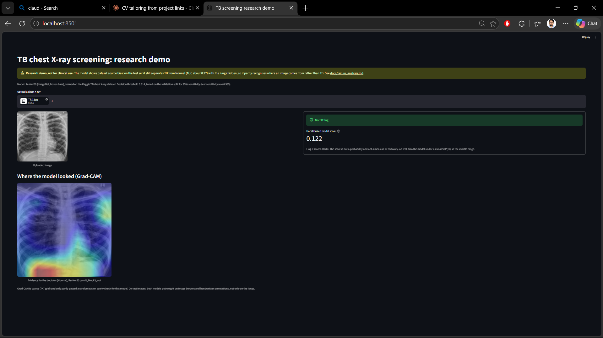
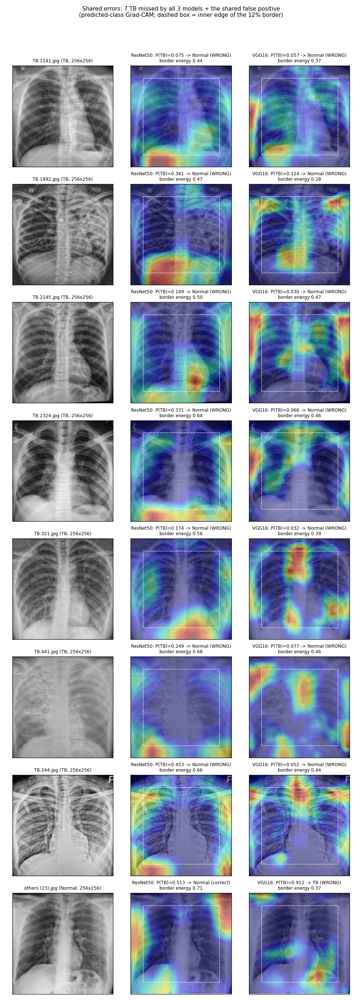

# Tuberculosis detection from chest X-rays: a case study in dataset confounding

> **TL;DR:** ROC-AUC 0.998 on the internal test set, but the models still separate the classes with the lungs hidden (AUC ≈ 0.97). They partly detect *which source an image comes from*, not TB. See [Key finding](#key-finding-dataset-confounding).

[](https://github.com/shubhampandey97/tuberculosis-detection-v2/actions/workflows/ci.yml)


## Summary

This project trains three ImageNet transfer-learning models (ResNet50, VGG16 and EfficientNetB0) to flag TB on chest X-rays, and then audits them. The pipeline uses:
- a de-duplicated, stratified, seeded train/val/test split;
- one preprocessing path shared by training, evaluation and the app;
- screening metrics with bootstrap confidence intervals, and a threshold tuned on the validation set;
- calibration, masking and Grad-CAM analyses.

The audit's main result is a negative one. In this dataset the TB and Normal images come from different sources, and the models learn that difference: markers, handwritten annotations, compression. The internal scores are therefore an **upper bound**, not evidence of clinical performance.

**This is a research and portfolio project, not a medical device. Do not use it for diagnosis.**



*TB.1.jpg (a TB image carrying the Normal-style marker: an "L" in the top-right corner) is not flagged: score 0.122, threshold 0.614. This image is from the **training** split, so it's an example of the bias, not a held-out result.*

## Results (held-out test set)

- **Test set:** 448 images (77 Normal, 371 TB), never used for training, threshold tuning or model selection.
- **Primary model:** ResNet50, chosen on **validation** AUC.
- **Threshold:** for each model, the highest threshold that gives **≥ 95% sensitivity on the validation set**, applied unchanged to test.
- **Intervals:** 95% CIs from a stratified bootstrap (2,000 resamples, seed 42).
- **Rounding:** values are truncated, not rounded, to 3 decimals.

| model | threshold | sensitivity | specificity | PPV | NPV | F1 | ROC-AUC |
|---|---|---|---|---|---|---|---|
| **ResNet50 (primary)** | 0.6142 | **0.935** (0.908–0.959) | **1.000**\* (77/77) | 1.000\* (347/347) | 0.762 (0.693–0.836) | 0.966 (0.951–0.979) | **0.998** (0.996–0.999) |
| VGG16 | 0.2357 | 0.929 (0.902–0.954) | 0.987 (0.961–1.000) | 0.997 (0.991–1.000) | 0.745 (0.675–0.819) | 0.962 (0.947–0.976) | 0.991 (0.982–0.998) |
| EfficientNetB0 | 0.3257 | 0.946 (0.921–0.967) | 0.987 (0.961–1.000) | 0.997 (0.991–1.000) | 0.791 (0.723–0.863) | 0.970 (0.957–0.982) | 0.996 (0.991–0.999) |

\* There were no errors, so the bootstrap interval collapses to 1.000–1.000. Exact (Clopper–Pearson) 95% lower bounds: specificity ≥ 0.953 and PPV ≥ 0.989.

How to read these numbers:
- **The 95% sensitivity target was met on validation but not on test** (0.929–0.946).
- **PPV and NPV reflect this dataset's 83% TB prevalence,** not a screening population.
- **The scores are not calibrated.** P(TB) is under-estimated in the middle range.

Full tables, results at threshold 0.5, and calibration: [docs/audit.md](docs/audit.md) (goal 4) and [artifacts/clinical/](artifacts/clinical/).

### Before and after the preprocessing fix

The original pipeline trained on pixels scaled to [0, 1] but evaluated on raw 0–255 pixels, and none of the models got its own `preprocess_input` (audit §5.1). It also evaluated on the validation split it had trained against.

| model | legacy ROC-AUC (**invalid**) | fixed ROC-AUC (held-out test) |
|---|---|---|
| ResNet50 | 0.302 | 0.998 |
| VGG16 | 0.985 | 0.991 |
| EfficientNetB0 | 0.148 | 0.996 |

The legacy numbers come from the broken preprocessing and a leaky, different split. They show that the bug was fixed; they are **not** a fair comparison of performance. They are kept in [artifacts/legacy/](artifacts/legacy/README.md) for this table only.

A second, smaller mismatch turned up while building the app: decoding JPEGs with PIL instead of TensorFlow (a different IDCT) shifted test scores by up to 0.024. The app now uses the same TensorFlow decode as training (max difference 1.6e-7 against the saved test predictions).

## Key finding: dataset confounding

1. **Metadata alone predicts the label.** A depth-3 decision tree that never sees the anatomy, only file size, brightness and contrast, reaches **AUC 0.918** (5-fold CV). File size alone reaches 0.861. Normal images all share one look (an "L" marker, similar exposure); TB images carry "R" markers, handwritten names and dates, and varied exposure. Source: [notebooks/01_data_audit.ipynb](notebooks/01_data_audit.ipynb), audit §5.3 item 7.
2. **The models still work with the lungs hidden.** With the central 170×170 of each 224×224 test image replaced by grey, test AUC stays at **0.971** (ResNet50), **0.974** (VGG16) and **0.912** (EfficientNetB0). Mean brightness alone gives only 0.576, so the grey fill doesn't explain it. ("Lungs hidden" is approximate: the lung tops and outer lung edges stay visible.)
3. **Grad-CAM lands on annotations.** In several correctly detected TB images the heatmaps sit on handwritten text and labels at the image edges. VGG16 puts about half of its TB evidence on the outer 12% border.
4. **The shared misses look like the Normal source.** The 7 TB images that all three models miss have Normal-like large files and low contrast, and none has the handwriting. **TB.1892** shows visible opacities and is still called Normal by every model (P(TB) 0.361 for ResNet50, 0.124 for VGG16).



*Grad-CAM for the decision made (ResNet50 middle, VGG16 right) on the 7 shared misses and the one shared false positive. The dashed box marks the inner edge of the 12% border.* Full analysis: [docs/failure_analysis.md](docs/failure_analysis.md).

## Limitations

- **Two sources, one per class.** The internal test set shares that confounding, so it can't measure TB detection by itself. No external validation has been done yet; a single-source dataset such as Shenzhen or Montgomery is the next step.
- **No patient IDs.** A patient-level split isn't possible. Exact duplicates were removed (26 copies), but images from the same patient may still appear in different splits.
- **Small Normal class.** There are 509 Normal images in total and 77 in test, so specificity has wide uncertainty.
- **Uncalibrated scores.** The app shows an "uncalibrated model score", not a probability.
- **Stretched images.** 124 TB images are non-square and get stretched by the 224×224 resize. The subgroup analysis found no clear effect, but with only 18 such images in test it can't rule one out.
- **Approximate explanations.** Grad-CAM is coarse (7×7 for ResNet50) and only partly passed a randomisation sanity check for ResNet50.
- **Frozen backbones.** Only the classification head was trained, on CPU.

## Next steps

1. **External validation** on a single-source dataset (Shenzhen or Montgomery), where TB and Normal share one acquisition pipeline.
2. **Remove the shortcut:** retrain on border-masked or lung-cropped images, then repeat the masking test. The lungs-hidden AUC should drop while the unmasked AUC holds.
3. **Calibration and threshold:** recalibrate the scores on val, and choose the screening threshold with a safety margin (the current one missed 95% sensitivity on test).
4. **Engineering:** pytest tests and CI, then a FastAPI endpoint, a working Docker image and a model card.
5. **Clinical review** of the 7 shared misses, especially TB.1892.

## How to reproduce

**1. Environment** (Python 3.10, CPU is enough). `requirements-lock.txt` is the exact Windows environment the results were produced with.

```bash
git clone https://github.com/shubhampandey97/tuberculosis-detection-v2.git
cd tuberculosis-detection-v2
conda create -n tb_v2_env python=3.10 -y
conda activate tb_v2_env
pip install -r requirements.txt
```

**2. Data.** Download the dataset from Kaggle: <https://www.kaggle.com/datasets/yasserhessein/tuberculosis-chest-x-rays-images>. See the Kaggle page for the original source and licence. Place it so the folders are:

```text
data/Dataset of Tuberculosis Chest X-rays Images/Normal Chest X-rays/   (514 images)
data/Dataset of Tuberculosis Chest X-rays Images/TB Chest X-rays/       (2,494 images)
```

**3. Pipeline.** Run every command from the repo root. The times are the CPU times measured for this project.

```bash
python -m src.pipeline.make_splits          # de-duplicate + 70/15/15 split -> data/splits.csv (seconds; deterministic)
python -m src.pipeline.data_audit           # optional: metadata confounding checks -> reports/data_audit/
python -m src.pipeline.smoke_test           # 1-epoch check on ~200 images per model (a few minutes)
python -m src.pipeline.train_pipeline       # trains all 3 models (about 2.9 h on CPU)
python -m src.pipeline.evaluate             # test metrics + val/test predictions -> artifacts/
python -m src.pipeline.evaluate_clinical    # CIs, threshold, calibration, masking (about 6 min)
python -m src.pipeline.gradcam_analysis     # Grad-CAM attention + galleries (about 9 min)
```

**Tests and lint** (the same checks CI runs). Tests that need the dataset images or the trained models skip automatically when those are missing.

```bash
pip install -r requirements-dev.txt
ruff check .
pytest
```

**4. Demo app** (needs the trained ResNet50 and `artifacts/clinical/thresholds.json`):

```bash
streamlit run app/streamlit_app.py
```

The app flags an upload as "TB suspected" when the score is at or above the val-tuned threshold (0.614), and shows the predicted-class Grad-CAM. It displays a "Research demo, not for clinical use" banner.

## Repository map

```text
app/streamlit_app.py           Streamlit demo (ResNet50, tuned threshold, Grad-CAM, disclaimer)
src/config/config.yaml         paths, seed, models, training and augmentation settings
src/components/
  data_loader.py               tf.data pipeline from data/splits.csv (raw 0-255 RGB)
  model_builder.py             frozen ImageNet bases + head; preprocessing inside the model
  gradcam.py                   Grad-CAM on the logit, NaN guard, overlay
  inference.py                 single-image inference shared by the app
src/pipeline/
  make_splits.py               de-duplication + stratified seeded split
  data_audit.py                metadata confounding checks
  train_pipeline.py            training with early stopping / checkpointing
  smoke_test.py                1-epoch pipeline check
  evaluate.py                  test metrics, per-image predictions, model selection on val
  evaluate_clinical.py         screening metrics, CIs, threshold, calibration, masking
  gradcam_analysis.py          attention statistics and galleries
  gradcam_pipeline.py          Grad-CAM for one image from the command line
src/utils/                     config loader, global seeds
data/splits.csv                the split (images are not in the repo)
artifacts/                     metrics, predictions, clinical/, gradcam/, legacy/ (invalid old results)
notebooks/01_data_audit.ipynb  data audit with plots
docs/audit.md                  full code audit and status of every upgrade goal
docs/failure_analysis.md       Grad-CAM failure analysis
tests/                         pytest suite (synthetic data; data/model tests auto-skip)
.github/workflows/ci.yml       CI: ruff + pytest on Ubuntu, Python 3.10
legacy/pytorch/                unused early PyTorch prototype (not maintained)
```

The `Dockerfile` is out of date and not supported yet; a working container and an API are planned.

## Author

Shubham Pandey · GitHub: <https://github.com/shubhampandey97>
